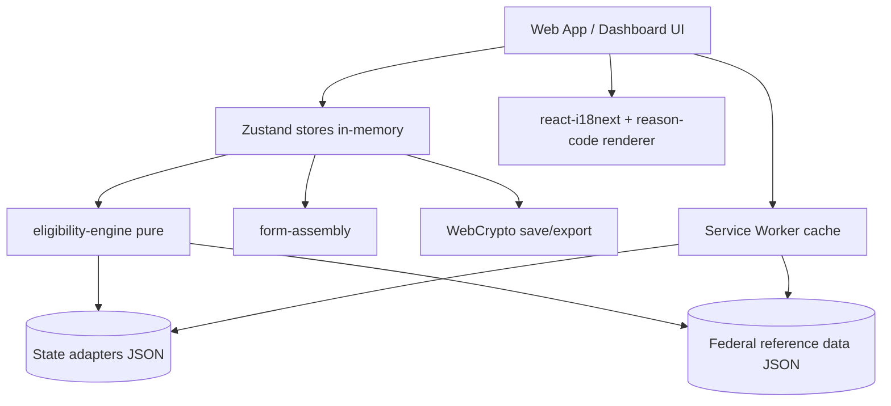
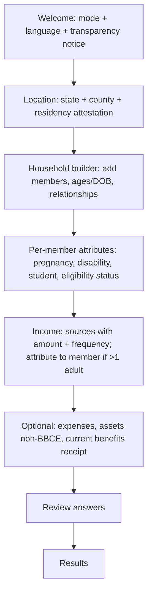

# OpenBridge — Design (Phase 1)

> Status: **Draft.** Design for the Phase 1 scope defined in `requirements.md` (v4). Decisions
> here trace back to that document's Decisions Log (Q1–Q43). Non-Phase-1 concerns (backend,
> Cognito, multi-user) are noted where they shape extensibility but are not designed in detail.

## 1. Overview

OpenBridge Phase 1 is a **fully client-side** Progressive Web App. There is no backend: the
eligibility engine, form assembly, encryption, and all personal data live in the browser. State
rules and federal reference data ship as **versioned static JSON** bundled with each release and
edge-cached via CloudFront.

The design is organized around three ideas from the requirements:

1. **A pure, deterministic eligibility engine** with no I/O, no localization, and no side effects —
   it takes a household profile plus a state adapter and returns structured results with reason
   codes. This makes it testable with golden fixtures (Q21) and reusable across the web app and the
   navigator dashboard.
2. **Data-driven state adapters** so new states are config + fixtures, not code (Q7, Q28, Q39).
3. **Privacy by architecture** — memory-only by default, client-side encryption for anything the
   user chooses to keep, and no analytics or error transmission in Phase 1 (Q20, Q26, Q32, Q33).

## 2. Architecture

### 2.1 Package layout (Turborepo monorepo)

```
packages/
  eligibility-engine/   Pure TS. No DOM, no i18n, no network. Exports evaluateEligibility().
  form-assembly/        Pure-ish TS + @react-pdf/renderer. Profile+results -> PDFs & guides.
  shared/               Types, constants, reason-code keys, currency/date utils. No deps on others.
  web-app/              React PWA. Owns UI, i18n, intake, stores, service worker, encryption.
  org-dashboard/        React app (Phase 2 feature-flagged) reusing engine + shared + web-app parts.
data/
  federal/              FPL tables (contiguous/AK/HI), SNAP allotments/deductions, with provenance.
  states/{oh,tx,wa}/    snap.json, medicaid.json, wic.json, meta.json, fixtures/
  referrals/            Static directory entries.
```

**Dependency direction (one-way, no cycles):**

```
shared  ←  eligibility-engine  ←  form-assembly
   ↑               ↑                    ↑
   └──────────  web-app  ──────────────┘
                  ↑
            org-dashboard
```

`shared` depends on nothing. `eligibility-engine` and `form-assembly` depend only on `shared`. UI
packages depend on all lower layers. Reference data and adapters are loaded as data (imported JSON
or fetched static assets), not as code dependencies.

### 2.2 Layered runtime view



The engine never touches the store, network, or DOM. The UI is the only layer that localizes,
persists, or encrypts.

## 3. Eligibility Engine

### 3.1 Evaluation pipeline

`evaluateEligibility(profile, adapter, evaluationDate, programs?)` runs this pipeline:

1. **Normalize** the profile: derive each `IncomeSource` monthly amount (`normalizeMonthly`), sum to
   `grossMonthlyIncome`, resolve `fplRegion` from `stateCode`, compute member ages from
   `dateOfBirth`/`age` at `evaluationDate`.
2. **Resolve program set**: the requested programs ∩ programs the adapter supports. Missing programs
   yield an `unknown` result with a "not yet supported" reason (Q15).
3. **Evaluate each program independently** (Q40) by calling its evaluator. No evaluator reads another
   evaluator's output; adjunctive eligibility uses only `receives*` actual-receipt flags.
4. **Assemble** `EligibilityResult` with per-program results (each carrying its own `fplCalculation`,
   Q38) and the `evaluationDate`/`dataVersion` stamp.

The engine is synchronous and pure. Adapters and federal data are passed in by the caller (the store
loads them), keeping the engine free of I/O.

### 3.2 Program evaluator contract

Each program evaluator is a pure function:

```ts
type ProgramEvaluator = (
  profile: NormalizedProfile,
  adapter: StateAdapter,
  federal: FederalData,
  evaluationDate: string,
) => ProgramEligibilityResult;
```

Household-scoped evaluators (SNAP, LIHEAP, TANF) return a single outcome. Per-member evaluators
(Medicaid, CHIP, WIC) compute a `MemberEligibility` for each relevant member and set the program
`outcome` to the **most encouraging** member outcome (Q37), with `scope: 'per_member'`.

### 3.3 Household derivation

Per Q1, each program derives its own household from the shared roster. Design of the two non-trivial
cases:

**SNAP household** — people who live together and customarily purchase and prepare food together.
Phase 1 proxy: everyone on the roster is one SNAP household unless a member is marked as separately
purchasing/preparing (a rare intake toggle, defaulted off). Spouses and children under 22 must be in
the same unit. This matches the common case; edge cases downgrade to `possibly_eligible`.

**Medicaid MAGI household** — this is the algorithm most likely to be gotten wrong, so it is specified
explicitly. MAGI household is built per person from tax relationships:

```
For each member M:
  if M is a tax filer (not claimed as a dependent by anyone):
      household(M) = M + spouse(if living together) + all tax dependents M claims
  else if M is a tax dependent:
      if M meets a non-filer exception
         (dependent who is not spouse/child of the taxpayer,
          OR child claimed by a non-custodial parent,
          OR child living with both parents who don't file jointly):
          household(M) = non-filer rule (below)
      else:
          household(M) = household of the taxpayer who claims M
  else (non-filer):
      household(M) = M + spouse + M's children under 19 living together
                     (+ if M is a child: M's parents and siblings under 19 in the home)
  A pregnant member counts as herself + expected number of children (>= +1).
```

Phase 1 does **not** collect full tax-filing detail (to keep intake short and non-intimidating). The
design uses a **relationship-and-age approximation** of the non-filer rule as the default, and adds
**two optional intake questions** ("Do you file taxes?" and "Does anyone claim you as a dependent?")
that, when answered, switch to the filer/dependent branches for accuracy. When tax structure is
ambiguous *and* it would change the outcome (household size straddles a threshold), the member result
is downgraded to `possibly_eligible` with `MEDICAID_HOUSEHOLD_ASSUMPTION` — honoring the cautious
principle (Q6). This keeps the common single-family case correct and simple while staying honest about
complex tax situations.

### 3.4 Income normalization

`normalizeMonthly(source)` applies the Q18 factors:

| frequency | factor |
|---|---|
| monthly | ×1 |
| annual | ÷12 |
| semimonthly | ×2 |
| biweekly | ×2.16667 |
| weekly | ×4.33333 |
| hourly | × hoursPerWeek × 4.33333 |

Self-employment income is entered as a net figure. Currency is handled in integer **cents**
internally to avoid float drift; rounding follows each program's rule at the comparison step (SNAP
rounds standard deductions per FNS; documented per-evaluator).

### 3.5 Outcome determination

A shared helper enforces the Q6/Q19 cautious ladder so every evaluator behaves consistently:

```ts
function decideOutcome(ctx: {
  hardDisqualifier: boolean;        // e.g. income far over limit AND no pathway
  passesAllHardTests: boolean;
  reliesOnUnverifiable: boolean;    // self-reported income, status
  withinMarginOfThreshold: boolean; // <=10% (Q6)
  missingRequiredInput: boolean;    // per §7.1 table (Q39)
  uncomputableFactor: boolean;      // WIC risk, vehicle assets (Q19, Q22)
  noPlausiblePathway: boolean;
}): EligibilityOutcome
```

Rules, in order: uncomputable/missing/near-threshold → `possibly_eligible`; hard disqualifier with no
pathway → `ineligible`; passes but unverifiable → `likely_eligible`; passes verified → `eligible`;
otherwise `unknown`. Status alone never yields `ineligible` (Q17). Ties resolve to the more encouraging
outcome.

### 3.6 Reason-code catalog

Reason codes are the engine's only "language" (Q8). Design:

- **Location:** keys live in `shared/reason-codes.ts` as string constants; English strings and
  parameter contracts live in `web-app/locales/en/reasons.json`. The engine imports only the keys.
- **Naming:** `SCREAMING_SNAKE`, prefixed by concern: `SNAP_GROSS_INCOME_WITHIN_LIMIT`,
  `MEDICAID_HOUSEHOLD_ASSUMPTION`, `WIC_RISK_ASSESSED_AT_CLINIC`, `STATUS_NEEDS_HUMAN_REVIEW`,
  `RESULT_LIMITED_BY_MISSING_INCOME_ATTRIBUTION`, `DATA_MAY_BE_OUT_OF_DATE`, `VEHICLE_ASSET_MAY_APPLY`.
- **Params:** each code declares a typed param shape (e.g. `{ limit: number, income: number }`) so the
  UI can interpolate localized, currency-formatted values.
- **Categories:** `factor` (drove a test), `assumption` (engine had to assume), `scope` (out of scope /
  see navigator), `notice` (freshness, transparency). Categories let the UI style them consistently.
- **CI enforcement (Q25):** a test asserts every key used by the engine has an English string; missing
  non-English strings warn only.

## 4. State Adapters & Reference Data

### 4.1 Adapter schema and loading

Adapters are the `StateAdapter` shape from requirements §10, one folder per state. In Phase 1 the three
pilot adapters (OH, TX, WA) are **statically imported** (only 3, well within the 250KB budget). The
loader is abstracted behind `loadAdapter(stateCode)` so Phase 2+ can switch to lazy `fetch()` of
per-state JSON from CloudFront without touching callers.

### 4.2 Validation & provenance

`scripts/validate-state-adapter.ts` runs in CI and validates each adapter against a Zod schema:
required program configs, required provenance sources for required values (Q28), a valid
`verificationStatus`, and that every `fixtures/` case passes. `verificationStatus: 'draft'` adapters
build and load but the UI shows the unverified caveat (Q10/5.10.4).

### 4.3 Federal reference data & freshness

`data/federal/` holds the three FPL tables and SNAP allotments/deductions, each with `effectiveDate`
and `expectedRefreshDate`. `scripts/seed-fpl-data.ts` regenerates these from source and bumps
`dataVersion`. At runtime the app compares `expectedRefreshDate` to the current date and, if past,
renders the `DATA_MAY_BE_OUT_OF_DATE` notice (Q29). The two annual refreshes (Jan FPL, Oct SNAP) are
documented as release checklists in `docs/`.

## 5. Frontend / PWA

### 5.1 App shell & routing

Single-page app with a small router. Top-level routes: `/` (welcome + mode/language), `/screen`
(intake wizard), `/results`, `/program/:id`, `/help` (referrals), `/resume` (import file). The
navigator dashboard (`/dashboard`, Phase 2) is feature-flagged.

### 5.2 Intake flow

A linear wizard with progressive disclosure and branching, designed for a ~30-minute library session
and 6th–8th grade reading level (Q34):



Branching rules keep it short: pregnancy/eligibility-status asked per member; the income-attribution
step appears only when there is more than one adult (Q36); the asset step appears only for non-BBCE
states (TX); the two optional MAGI tax questions (§3.3) appear only when the household has structure
that could matter (multiple potential filers). Each data-collecting screen shows the plain-language
"stored only on this device" transparency banner (Q16/5.6).

### 5.3 State management & modes

Zustand stores hold intake and results **in memory only** (Q26). Stores:

- `intakeStore` — the in-progress `HouseholdProfile`.
- `resultStore` — the latest `EligibilityResult`.
- `sessionStore` — `AppMode`, language, deployment config, inactivity timer, dirty flag.
- `dashboardStore` (Phase 2) — an array of client sessions for navigator batch mode.

**Modes (Q41):** in `individual` mode the inactivity timer runs (§5.7). In `navigator` mode the timer
is replaced by a manual lock/clear, and `dashboardStore` retains multiple in-memory client sessions
with explicit "next client" / "clear client" actions. Neither mode writes to disk unless the user
exports.

### 5.4 Offline / service worker

Vite PWA plugin (Workbox). Precache the app shell, locale files, adapters, and federal data. Cache
strategy: app assets `StaleWhileRevalidate`; data JSON `CacheFirst` keyed by `dataVersion` so a new
release busts the cache (Q7). A minimal update prompt tells the user when a new version is ready. All
core flows work offline after first load (5.8).

### 5.5 i18n & reason-code rendering

`react-i18next` with lazy-loaded locale bundles (en, es). A `renderReason(reasonCode)` helper resolves
the fallback chain **active locale → English → humanized key** (Q25) and interpolates params with
locale-aware currency/number formatting (`Intl.NumberFormat`). Factor rows and next steps use the same
mechanism. The readability CI check (Flesch–Kincaid) runs against `locales/en/*.json`.

### 5.6 Accessibility

WCAG 2.2 AA target (Q13): semantic HTML, focus management between wizard steps, visible focus, labels
on every input, 44px touch targets, prefers-reduced-motion, and full keyboard operability. Numeric
inputs get inline examples and accept `$`/commas (Q34). Generated PDFs are tagged for accessibility.

## 6. Privacy & Security

### 6.1 Data lifecycle

Personal data exists only in Zustand memory during a session. "Clear my data" and inactivity
auto-clear wipe stores and any transient caches (Q26). Nothing is written to `localStorage`,
`IndexedDB`, or autofill. The transparency banner reflects current state ("only on this device").

### 6.2 Encryption & saved-file format (Q20)

Saving progress or an encrypted bundle produces a self-describing JSON envelope the user downloads:

```json
{
  "format": "openbridge.save.v1",
  "dataVersion": "2026.1",
  "kdf": { "algo": "PBKDF2", "hash": "SHA-256", "iterations": 310000, "salt": "<b64>" },
  "cipher": { "algo": "AES-GCM", "iv": "<b64>" },
  "ciphertext": "<b64>"
}
```

Flow: passphrase → PBKDF2 (per-file random salt, high iterations) → AES-GCM key → encrypt the
serialized `HouseholdProfile` (+ tracking status). The key is never stored; there is no recovery.
Import reverses this and runs the `dataVersion` stale-check (5.4.4). A React error on a wrong passphrase
surfaces a friendly "couldn't unlock this file" message. The plain (unencrypted) review-bundle PDF is
offered separately for users who prefer a document they can read directly (Q10).

### 6.3 PII inventory & error handling

The collected PII is enumerated in `docs/PRIVACY_MODEL.md`: names are **not** collected during
screening (only relationships/ages); income, `eligibilityStatus`, DOB, and address-level `county` are
the sensitive fields. A top-level React error boundary degrades to a friendly offline-safe message.
Error capture, if ever added, is allowlist-based and never includes profile data or reason-code params
(Q33); Phase 1 transmits nothing.

## 7. Form Assembly

`form-assembly` turns a profile + results into documents:

- **Ohio SNAP & Medicaid** — `@react-pdf/renderer` templates that mirror the official Ohio Benefits
  form field layout, filled from the profile (Q11, Q43). Output is English.
- **Generic summary sheet** — for every other program/state, a clean, printable rendering of all
  entered data plus each program's outcome and next steps.
- **Language companion guide** — when the UI language is not English, a localized guide explaining how
  to complete and submit the English application (Q43).
- **Review bundle** — the generated PDFs + summary combined for referral; offered plain or encrypted
  (Q10/5.12).

Templates are data-driven from a field-mapping config so new official forms are added without engine
changes. Document text uses the same reason/label codes for consistency.

## 8. Referrals & Review Bundle

The `data/referrals/` directory holds `ReferralEntry` records (legal aid / gov / bar referral / firm),
filtered by the user's state/county and category (e.g., immigration for status-complex cases from
Q17). Contact is device-native (`tel:`/`mailto:`), never server-mediated (Q10). Any export shows the
explicit consent screen first (5.12.4). Every referral view carries the no-endorsement disclaimer and
the app-wide Terms of Use (5.13).

## 9. Error Handling Strategy

| Condition | Handling |
|---|---|
| Missing required input for a program | `possibly_eligible` + specific reason code (never crash) |
| Unsupported program in adapter | `unknown` + "not yet supported" + official link |
| Uncomputable factor (WIC risk, vehicle) | `possibly_eligible` + explanatory code |
| Corrupt/incompatible saved file | Friendly "couldn't open this file" message; no stack to user |
| Wrong passphrase | Friendly "couldn't unlock" message; allow retry |
| Stale reference data | Non-blocking freshness caveat banner |
| Unexpected runtime error | React error boundary → friendly, offline-safe screen; nothing transmitted |

The engine itself is total: every program returns a result object; it never throws on user data. Zod
validates at the intake boundary so malformed data is caught with user-friendly messages before it
reaches the engine.

## 10. Testing Strategy

- **Engine unit tests (Vitest):** per-evaluator tests for thresholds, deductions, household derivation,
  outcome ladder, and income normalization (integer-cent math).
- **Golden fixtures (Q21):** each adapter's `fixtures/*.json` (`profile → expected outcome per program`,
  incl. per-member cases) run in CI; divergence fails the build. Ohio fixtures are SME-signed.
- **Adapter validation:** `validate-state-adapter.ts` (schema + provenance + fixtures) in CI.
- **Localization CI:** every engine reason key has an English string; readability check on English copy.
- **E2E (Playwright):** full intake → results → PDF → save/import → clear, in both modes and both
  languages; offline run after first load.
- **Accessibility:** axe automated checks in CI plus a manual screen-reader pass checklist (noting full
  WCAG conformance needs manual assistive-tech testing).

## 11. Deployment

Static build deployed to **S3 + CloudFront** via **GitHub Actions** (Q32):
lint → typecheck → unit/fixtures → build → deploy. AWS CDK (`infra/`) defines the S3 bucket
(private, OAC), CloudFront distribution (HTTPS, SPA rewrite), and CloudWatch **infrastructure** metrics
only — no user analytics. `DeploymentConfig` (mode default, auto-clear timeout, local resources) is a
static JSON asset an org can override when self-hosting (documented in `docs/DEPLOYMENT.md`, Q35).

## 12. Design Decisions & Rationale

| Area | Decision | Rationale | Traces to |
|---|---|---|---|
| Engine purity | No I/O, no i18n, no DOM in the engine | Deterministic, fixture-testable, reusable in dashboard | Q8, Q21 |
| MAGI households | Relationship/age approximation + optional tax questions + cautious downgrade | Correct for common case, honest on complex tax structures, short intake | Q1, Q6, Q37 |
| Currency | Integer cents internally | Avoids float drift in threshold comparisons | Q18 |
| Adapter loading | Static import Phase 1, `loadAdapter` seam for lazy later | Simple now, no rework to scale to 50 states | Q7, Q13 |
| Save format | Self-describing versioned envelope | Forward-compatible, enables stale-check on import | Q20, Q31 |
| Modes | Separate timer/retention behavior, shared engine | Reconciles kiosk hygiene with batch screening | Q26, Q41 |
| PDFs | Data-driven field mapping + English form + localized guide | Adds forms without code; matches official layout; serves non-English users | Q11, Q43 |

## 13. Open Design Questions (defer to tasks / later phases)

- Exact Ohio Benefits form field mapping (needs the official form to template against).
- Full non-filer MAGI exception coverage vs. the Phase 1 approximation — revisit with SME input.
- Whether the two optional tax questions test well with users or add friction (usability testing).
- SNAP self-employment allowable-expense itemization (Phase 2).
- Precise inactivity timeout defaults per mode (tune with pilot orgs).

## 14. Next Step

Produce `tasks.md`: an incremental, test-driven implementation plan for Phase 1, sequenced so the
pure engine + fixtures land first (highest correctness leverage), then adapters, then the PWA/UI,
then form assembly and referrals.
