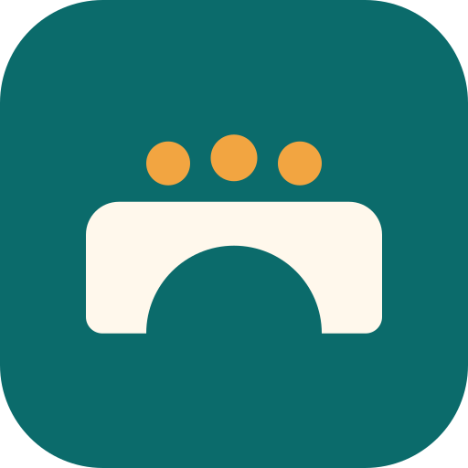

# OpenBridge logo

The OpenBridge logo is a stone bridge with an open arch and three people crossing it, next to the
name in Atkinson Hyperlegible. The bridge stands for the path to help; the people stand for the
households and navigators who use it.

  
  &nbsp;&nbsp;
  

## Files

| File                            | Use it for                                                     |
| ------------------------------- | -------------------------------------------------------------- |
| `openbridge-logo.svg`           | Light backgrounds: web pages, documents, slides                |
| `openbridge-logo-dark.svg`      | Dark backgrounds (also used by the README in GitHub dark mode) |
| `openbridge-logo-mono.svg`      | One color: photocopies, stamps, single-color printing          |
| `openbridge-icon.svg`           | App icon and favicon (rounded square)                          |
| `openbridge-icon-maskable.svg`  | Source for Android and iPhone icons (full square, safe zone)   |
| `openbridge-social-preview.png` | GitHub social preview (1280 by 640). Upload it in Settings.    |
| `openbridge-social-preview.svg` | Editable source for the social preview                         |

Where the logo is used in the project:

- **Web app favicon** and **rule toolkit favicon:** the icon, inlined in each `index.html`, so it
  works on hosted, offline, and single-file builds without loading anything.
- **Install icons:** `packages/web-app/public/icon-192.png`, `icon-512.png`, and
  `icon-maskable-512.png` (listed in the PWA manifest in `packages/web-app/vite.config.ts`), and
  `apple-touch-icon.png` for iPhone and iPad home screens.
- **README:** the logo at the top, switching to the dark version in dark mode.

## Colors

| Name       | Hex       | Use                                 | Contrast                            |
| ---------- | --------- | ----------------------------------- | ----------------------------------- |
| Ink        | `#123B40` | The name, on light backgrounds      | 12.2:1 on white                     |
| Deep teal  | `#0B6B6B` | The bridge, and the icon background | 6.3:1 on white                      |
| Amber      | `#F2A541` | The three people (accent only)      | 2.1:1 on white, 3.1:1 on deep teal  |
| Cream      | `#FFF8EC` | Name and bridge on dark or teal     | 14.3:1 on night, 6.0:1 on deep teal |
| Light teal | `#5FC4BC` | The bridge on dark backgrounds      | 7.3:1 on night                      |
| Night      | `#0E2A2E` | Dark background                     |                                     |

WCAG asks for 4.5:1 for text and 3:1 for graphics people need to understand. The name and the
bridge meet both everywhere.

## Accessibility rules for using the logo

- **Amber is decoration.** It is too light to carry meaning on white, and the logo still reads as a
  bridge without it. Never use amber for text on a light background.
- **Match the background.** Use the regular file on light backgrounds and the `-dark` file on dark
  ones. Do not place the logo on a busy photo.
- **Text alternative.** When the logo is an image, its alt text is "OpenBridge". When the name
  already appears next to it as text, mark the image decorative (`alt=""`).
- **Size.** Keep the full logo at least 120 pixels wide on screens and 30 mm in print. Below that,
  use the icon.
- **Do not change it.** Do not stretch, recolor, rotate, add effects, or rearrange the parts.

## Fonts

The name is drawn as shapes, so the files need no fonts installed. The letters come from
[Atkinson Hyperlegible](https://www.brailleinstitute.org/freefont/) by the Braille Institute,
designed to be easy to read for people with low vision: "Open" in Regular and "Bridge" in Bold.
The font is under the SIL Open Font License 1.1, which allows this use.

## Status

This is the chosen logo. It has not had a professional design or trademark review. The app's
interface still uses its original blue (`#0b5cad`) for buttons and links; moving the interface to
the logo colors is a separate change that needs its own contrast checks.
